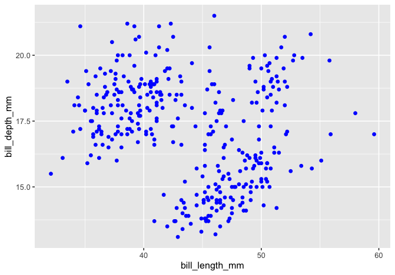
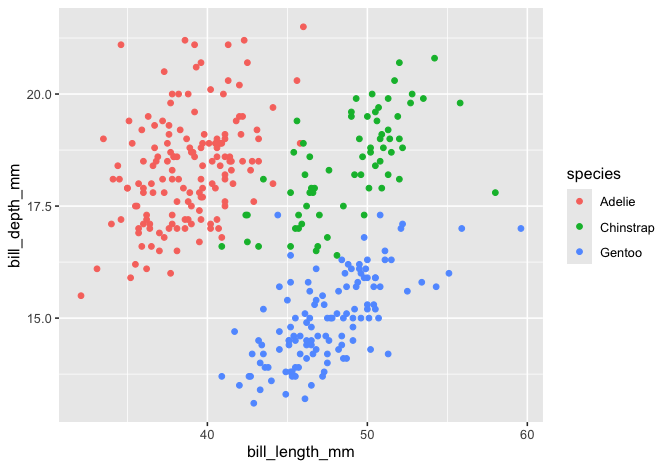
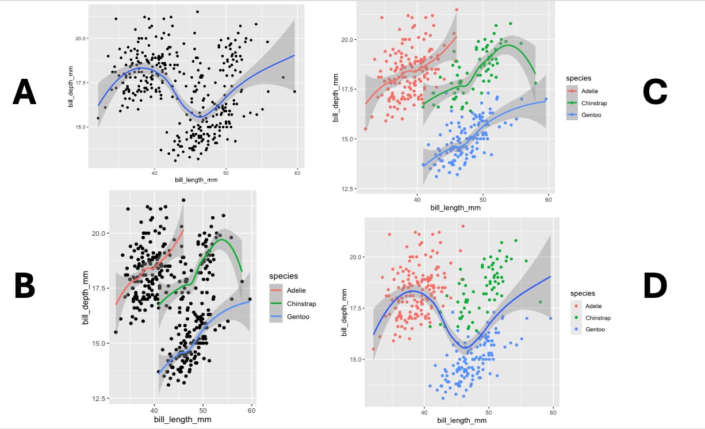
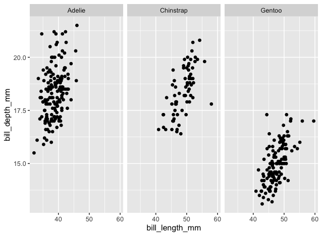

## Setup 🔧

Remember that we have to install packages only once, but we always have to call them into our workspace using `library()`.

```{webr}
# Load the packages
library(ggplot2) 
library(dplyr)
library(palmerpenguins)
library(tidyr)
```

<br>

## 1. Defining the required elements

Every plot we create with `ggplot2` requires the `ggplot()` function. When we run `ggplot()` on its own, it creates an empty, gray square—a blank canvas for us to do our "art"! Let's see it in action.

```{webr}
ggplot()
```

We need to add some arguments to `ggplot()` if we want to plot data. Arguments are the information we give to a function to change how the function behaves.

Let's plot `body_mass_g` and `flipper_length_mm`. To do so, we will need the following:

a.  the `data` argument to supply a dataset and

b.  the `mapping` argument to connect variables from the dataset to visual properties (i.e., aesthetics) of the plot.

::: {.callout-tip appearance="simple"}
**Your turn!**

**Fill in the following code chunk to supply the data `penguins` and map** `body_mass_g` **to the x-axis and** `flipper_length_mm` **to the y-axis.**

```{webr}
ggplot(data = _____, mapping = aes(x = _____, y = _____))
```
:::

We still have not plotted the data, though. The function `geom_point()` will add a scatter plot *layer* to our plot.

::: {.callout-tip appearance="simple"}
**Your turn!**

**Copy your code from above and then add `+ geom_point()`. Then, run the code chunk to see the result.**

```{webr}

```
:::

The `+` operator combines `ggplot2` functions. Without the `+`, R doesn’t know that you want to add `geom_point()` to the plot you started with `ggplot().` Missing the `+` operator or putting it on a new line are common errors people receive when using `ggplot2`.

> **Template for `ggplot()`**:
>
> ggplot(data = `DATAFRAME`{=html}, mapping = aes(x = `VARIABLE`{=html}, y = `VARIABLE`{=html})) + geom_point()

- `ggplot()` initiates a blank canvas where we can create our plot

- `data` supplies the dataset

- `aes()` determines which variable should be on the x-axis and which on the y-axis

- `geom_point()` adds a scatter plot layer

::: {.callout-tip appearance="simple"}
**Your turn!**

**Using the template above, create a scatter plot to show the relationship between `bill_length_mm` (x-axis) and `bill_depth_mm` (y-axis). Write your code from scratch without copying and pasting 🙂**

```{webr}

```
:::

::: {.callout-tip appearance="simple"}
**Your turn!**

**Let's rewrite our code above to (a) apply the pipe `|>` workflow and (b) get rid of the warning error by dropping NAs in the variables `bill_length_mm` and `bill_depth_mm.`**

```{webr}

```
:::

<br>

## 2. Customizing plots by changing *aesthetics*

Visual aspects like the color, shape, and size are called *aesthetics*.

The following code, for example, changes the `color` aesthetic for the scatter points. Run the code to see the result.

```{webr}
penguins |>
drop_na(bill_length_mm, bill_depth_mm) |>
ggplot(mapping = aes(x = bill_length_mm, y = bill_depth_mm)) +
geom_point(color = "blue")

```

::: {.callout-tip appearance="simple"}
**Your turn!**

**Edit the code below to turn the points "maroon" instead.**

```{webr}
penguins |>
drop_na(bill_length_mm, bill_depth_mm) |>
ggplot(mapping = aes(x = bill_length_mm, y = bill_depth_mm)) +
geom_point(color = "blue")
```
:::

ggplot2 recognizes a range of color names. Run the function `colors()` to see a list of options.

```{webr}
colors()
```

The following table contains some aesthetics that you can use with `geom_point()`:

+-----------+--------------------------------+------------------------------------------------------+
| Aesthetic | What it controls               | Use                                                  |
+===========+================================+======================================================+
| `color`   | Color                          | Quoted name of a color, e.g., “blue”                 |
+-----------+--------------------------------+------------------------------------------------------+
| `size`    | Size                           | Number                                               |
+-----------+--------------------------------+------------------------------------------------------+
| `shape`   | Shape (circle, triangle, etc.) | An integer between 0 and 25                          |
+-----------+--------------------------------+------------------------------------------------------+
| `alpha`   | Transparency                   | A number between 0 and 1                             |
|           |                                |                                                      |
|           |                                | - `alpha = 1` creates completely opaque points.      |
|           |                                |                                                      |
|           |                                | - `alpha = 0` creates completely transparent ones.   |
|           |                                |                                                      |
|           |                                | Setting `alpha` less than 1 helps with overplotting. |
+-----------+--------------------------------+------------------------------------------------------+

::: {.callout-tip appearance="simple"}
**Your turn!**

**Try the following arguments one by one so you can see their effects: `alpha = 0.6`, `shape = 18`, and `size = 3`. You can add these arguments to `geom_point()` using commas in between.**

```{webr}
penguins |>
drop_na(bill_length_mm, bill_depth_mm) |>
ggplot(mapping = aes(x = bill_length_mm, y = bill_depth_mm)) +
geom_point(color = "maroon")
```
:::

<br>

## 3. Mapping aesthetics to variables in the dataset

The following plots both alter the color of the points but differ in an important way. **What's the difference?**

| **Plot 1**               | **Plot 2**               |
|--------------------------|--------------------------|
|  |  |

To create the second plot, we need to create an *aesthetic mapping* between the variable `species` and `color`.

Here’s a first attempt to color the points by `species`. Unfortunately, it doesn’t work.

```{webr}
#| eval: false
penguins |>
drop_na(bill_length_mm, bill_depth_mm) |>
ggplot(mapping = aes(x = bill_length_mm, y = bill_depth_mm)) +
geom_point(color = species)
```

Aesthetic mappings like these need to be created inside `aes()`, so we need to add `color = species` inside `aes()`.

::: {.callout-tip appearance="simple"}
**Your turn!**

**Fill in the following code to create a plot that maps `species` to `color`.**

```{webr}
penguins |>
drop_na(bill_length_mm, bill_depth_mm) |>
ggplot(mapping = aes(x = bill_length_mm, y = bill_depth_mm)) + 
geom_point(mapping = aes(color = _____))
```
:::

We put the `color` aesthetic inside `geom_point()`. What do you think will happen if we move `color = species` inside `ggplot()`? See it yourself!

```{webr}
penguins |>
drop_na(bill_length_mm, bill_depth_mm) |>
ggplot(mapping = aes(x = bill_length_mm, y = bill_depth_mm, color = species)) +
geom_point()
```

::: callout-important
**Any aesthetics in `ggplot()` will apply to all the geoms that follow.**
:::

Earlier, you learned how to set shape so that all the points had the same shape. To *map* a variable to shape, add the mapping in `aes()`.

::: {.callout-tip appearance="simple"}
**Your turn!**

**Fill in the code to map `species` to `shape`.**

```{webr}
penguins |>
drop_na(bill_length_mm, bill_depth_mm) |>
ggplot(mapping = aes(x = bill_length_mm, y = bill_depth_mm, _____ = _____)) +
geom_point()
```
:::

<br>

## 4. Layering geoms

So far, we have learned how to use `geom_point()` together with `ggplot()`, but with ggplot, we can add multiple geoms to one plot. Let's add a regression line to our scatter plot by adding `geom_smooth().`

```{webr}
penguins |>
drop_na(bill_length_mm, bill_depth_mm) |>
ggplot(mapping = aes(x = bill_length_mm, y = bill_depth_mm)) + 
  geom_point() +
  geom_smooth()
```

**What do you think will happen if we add `color = species` inside `aes()` in `ggplot()`? 🕵️‍♀️ Hint: Any aesthetics in `ggplot()` will apply to all the geoms that follow.**



#### **Global aesthetics—applying aesthetics to all geoms that follow**

This one applies the `color` aesthetic mapping to both `geom_point()` and `geom_smooth()`.

```{webr}
penguins |>
drop_na(bill_length_mm, bill_depth_mm) |>
ggplot(mapping = aes(x = bill_length_mm, y = bill_depth_mm, color = species)) +
  geom_point() +
  geom_smooth()
```

#### **Local aesthetics—applying aesthetics to a specific geom**

This one applies the `color` aesthetic mapping only to `geom_point()`.

```{webr}
penguins |>
drop_na(bill_length_mm, bill_depth_mm) |>
ggplot(mapping = aes(x = bill_length_mm, y = bill_depth_mm)) + 
  geom_point(mapping = aes(color = species)) +
  geom_smooth()
```

This one applies the `color` aesthetic mapping only to `geom_smooth()`.

```{webr}
penguins |>
drop_na(bill_length_mm, bill_depth_mm) |>
ggplot(mapping = aes(x = bill_length_mm, y = bill_depth_mm)) + 
  geom_point() +
  geom_smooth(mapping = aes(color = species))
```

#### **Regression line**

`geom_smooth` defaults to the loess method for the regression line, but you can change that to the linear model by changing the `method` argument to `lm`.

```{webr}
penguins |>
drop_na(bill_length_mm, bill_depth_mm) |>
ggplot(mapping = aes(x = bill_length_mm, y = bill_depth_mm)) + 
  geom_point() +
  geom_smooth(method = "lm", mapping = aes(color = species))
```

<br>

## 5. Faceting with `facet_wrap()` and `facet_grid()`

Let's create a plot that looks like this:



The small plots representing the different species are called *facets*. The `facet_wrap()` function creates facets.

```{webr}
penguins |>
drop_na(bill_length_mm, bill_depth_mm) |>
ggplot(mapping = aes(x = bill_length_mm, y = bill_depth_mm)) + 
  geom_point() +
  facet_wrap(facets = vars(species))
```

::: {.callout-tip appearance="simple"}
**Your turn!**

**Fill in the code below to facet the plot by `island`.**

```{webr}
penguins |>
drop_na(bill_length_mm, bill_depth_mm) |>
ggplot(mapping = aes(x = bill_length_mm, y = bill_depth_mm)) + 
  geom_point() +
  facet_wrap(_____ = _____(_____))

```
:::

If you want to create facets based on two categorical variables, then you can use `facet_grid()` and indicate which variable you want in the columns and rows.

::: {.callout-tip appearance="simple"}
**Your turn!**

**Fill in the code below to facet the rows by `species` and columns by `island`.**

```{webr}
penguins |>
drop_na(bill_length_mm, bill_depth_mm) |>
ggplot(mapping = aes(x = bill_length_mm, y = bill_depth_mm)) +
  geom_point() +
  facet_grid(rows = vars(_____), cols = vars(_____))
```
:::

<br>

## 6. Labeling with `labs()`

Our plot could use some additional finesse, like a title. To add a title to a plot, use the function `labs()`:

```{webr}
penguins |>
drop_na(bill_length_mm, bill_depth_mm) |>
ggplot(mapping = aes(x = bill_length_mm, y = bill_depth_mm)) +
  geom_point() +
  facet_grid(rows = vars(species), cols = vars(island)) +
  labs(title = "_____")
```

`Labs()` can change many other labels, including the x and y axis labels.

```{webr}
penguins |>
drop_na(bill_length_mm, bill_depth_mm) |>
ggplot(mapping = aes(x = bill_length_mm, y = bill_depth_mm)) +
  geom_point() +
  facet_grid(rows = vars(species), cols = vars(island)) +
  labs(
    title = "_____",
    x = "_____",
    y = "_____"
    )
```

For other labels, see the documentation by running `?labs()`.

```{webr}
?labs()
```

Here is a figure that illustrates some of the arguments of `labs()`, such as `tag`, `subtitle`, and `caption`.

{fig-align="left" width="569"}

<br>

## 7. Application! 🏁

**Work in pairs or small groups to create the following figure. Use the code chunk below to type your answer.**

{fig-align="left"}

```{webr}

  
     
     


```

{fig-align="left" width="337"}

::: callout-caution
**BEFORE YOU CLOSE THIS PAGE, SAVE YOUR PROGRESS:**

1.  Right-click anywhere on the page

2.  Select *Print*

3.  Choose *Save as PDF*
:::

## Credits

This page contains materials from [Posit Academy (2025).](https://posit.co/products/enterprise/academy/)
