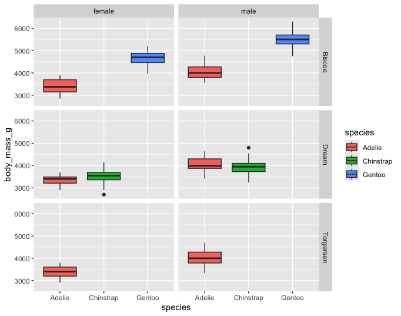
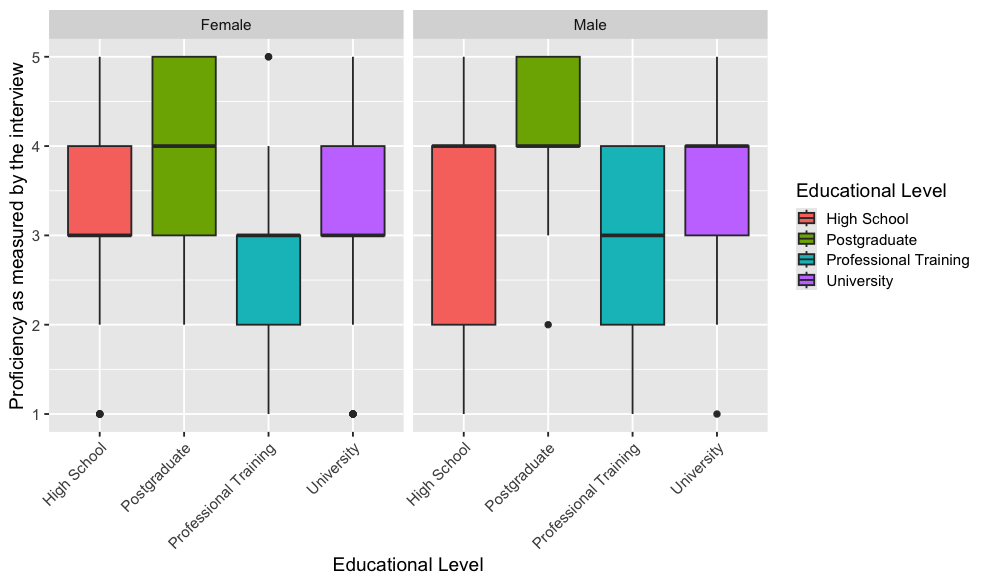
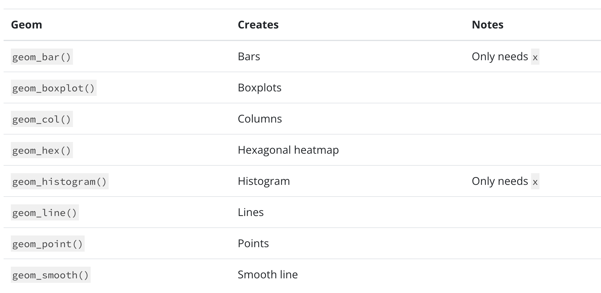

# 1. Setup

Remember that we have to install packages only once, but we always have to call them into our workspace using `library()`.

```{webr}
# Load the packages
library(ggplot2) 
library(dplyr)
library(palmerpenguins)
library(tidyr)
```

<br>

# 2. Box plots

We can use box plots to show the distribution of a numerical variable broken down by a categorical variable (e.g., body mass by species).

With box plots, we need to tell R what variable goes on the `x` and `y` axes. The y-axis is for the numerical variable while the x-axis is for the categorical grouping variable.

Let's examine `body_mass_g` across different `species` using `geom_boxplot()`:

```{webr}
penguins |> 
  drop_na(body_mass_g) |> 
  ggplot(mapping = aes(x = species, y = body_mass_g)) +
  ______________
```

Let's also give each species a different color by mapping the `fill` argument to the variable `species`

```{webr}
penguins |> 
  drop_na(body_mass_g) |> 
  ggplot(mapping = aes(x = species, y = body_mass_g, fill = ______)) +
  geom_boxplot() 
```

::: {.callout-tip appearance="simple"}
**Your turn!**

**Add onto the code below to recreate the plot below. Hint: `fill` and `facet_grid`.**

```{webr}
penguins |> 
  drop_na(body_mass_g) |> 
  ggplot(mapping = aes(x = species, y = body_mass_g)) +
  geom_boxplot()
```


:::

<br>

# 3. Histograms (For you to look at later)

We can use histograms to examine the distribution of values for a numerical variable. With histograms, we only need the `x` variable. **`y`** is created automatically and shows the counts.

Let's create a histogram for `body_mass_g` using `geom_histogram()`:

```{webr}
penguins |> 
  drop_na(body_mass_g) |>
  ggplot(mapping = aes(x = body_mass_g)) +
  ______________
```

We can color the bins to be able to see them more clearly:

- `color` -\> Color the outlines of bins

- `fill` -\> Color the inside of the bins

```{webr}
penguins |> 
  drop_na(body_mass_g) |>
  ggplot(mapping = aes(x = body_mass_g)) +
  geom_histogram(______ = "white", ______ = "steelblue")
```

We can also change the number of bins with `bins` or the width of the bins with `binwidth`:

```{webr}
penguins |> 
  drop_na(body_mass_g) |>
  ggplot(mapping = aes(x = body_mass_g)) +
  geom_histogram(fill = "steelblue", color = "white", _______ = 200)
```

::: {.callout-tip appearance="simple"}
**Your turn!**

**Update the code below so that we can see how `body_mass_g` values are distributed across the levels of the `sex` variable.**

**You can either map the variable `sex` to `fill` OR use `facet_wrap()`.**

```{webr}
penguins |> 
  drop_na(body_mass_g) |>
  ggplot(mapping = aes(x = body_mass_g)) +
  geom_histogram()
```
:::

<br>

# 4. Bar plots (For you to look at later)

Similar to histograms, we only need to provide `x`, which will be the categorical variable of interest. `y` will be automatically calculated and indicate how many observations fall into each category.

Let's count how many penguins we have in each `species`:

```{webr}
penguins |> 
  ggplot(mapping = aes(x = species)) +
  geom_bar()
```

::: {.callout-tip appearance="simple"}
**Your turn!**

**How can we color the species differently?**

```{webr}
penguins |> 
  ggplot(mapping = aes(x = species, ______ = _______)) +
  geom_bar()
```
:::

### Stacked bar plots

We can also use bar plots to show how one categorical variable is distributed within another categorical variable. To do this, we map one categorical variable to **`x`** and another to **`fill.`**

```{webr}
penguins |> 
  drop_na(sex) |>
  ggplot(mapping = aes(x = species, fill = sex)) +
  geom_bar()
```

### Side-by-side bar plots

If stacked bar plots are hard to compare, we can place the bars next to each other using **`position = "dodge"`**.

```{webr}
penguins |> 
  drop_na(sex)|>
  ggplot(mapping = aes(x = species, fill = sex)) +
  geom_bar(_________ = "dodge")
```

### Standardized bar plots

Sometimes we want to compare **proportions** instead of counts. We can do so with **`position = "fill"`**. Now, each bar will have the same height, and the breakdown will show the **proportion** of each subgroup.

```{webr}
penguins |> 
  drop_na() |>
  ggplot(mapping = aes(x = species, fill = sex)) +
  geom_bar(________ = "fill")
```

::: {.callout-tip appearance="simple"}
**Your turn!**

Create a **stacked bar plot** with `species` on the x-axis. Each bar should represent the total count of penguins for that species, with different fill colors indicating the `island` they come from.

```{webr}

```
:::

# 5. Further customizing your plots

Using `ggplot2`, you can customize pretty much any aspect of your plot. Here are two popular tools:

- **themes** control the overall appearance of the plot such as the background, grid lines, and text size

- **scales** control how colors are assigned to variables such as fill colors and outline colors

### **Themes**

Let's start with a basic box plot:

```{webr}
penguins |> 
  ggplot(mapping = aes(x = species, y = body_mass_g, fill = species)) +
  geom_boxplot()
```

We can now apply a theme to it.

```{webr}
penguins |> 
  ggplot(mapping = aes(x = species, y = body_mass_g, fill = species)) +
  geom_boxplot() +
  theme_minimal() 
```

### **Scales**

Because `species` is mapped to **`fill`**, we can use the **`scale_fill_manual()`** function to control the colors:

```{webr}
penguins |> 
  ggplot(mapping = aes(x = species, y = body_mass_g, fill = species)) +
  geom_boxplot() +
  scale_fill_manual(values = c(
      "Adelie" = "pink",
      "Chinstrap" = "steelblue",
      "Gentoo" = "peachpuff")
  )
```

Instead of manually selecting colors, we can also use a built-in palette with `scale_fill_brewer()`.

```{webr}
penguins |> 
  ggplot(mapping = aes(x = species, y = body_mass_g, fill = species)) +
  geom_boxplot() +
  scale_fill_brewer(palette = "Set2")
```

Click [here](https://r-graph-gallery.com/38-rcolorbrewers-palettes.html) to see all palettes.

::: {.callout-note appearance="simple"}
If our variable of interest was mapped to the `color` aesthetic, then we would use `scale_color_manual` and `scale_color_brewer`.
:::

<br>

# 6. Application! 🏁

### Download the dataset

```{webr}
#| context: setup
csv_url <- "https://tulaydixon.github.io/ECOLT26/data/BEST.csv"
download.file(csv_url, destfile = "BEST.csv", mode = "wb")

BEST <- read.csv("BEST.csv", stringsAsFactors = TRUE)

BEST
```

### **Task**

Reproduce the following box plot:



```{webr}

```

# 7. Want to learn more about different geoms?

You can find more information about them at <https://ggplot2.tidyverse.org/index.html> Go to *Reference* and then choose a geom to see that geom’s documentation.



------------------------------------------------------------------------

::: callout-caution
**BEFORE YOU CLOSE THIS PAGE, SAVE YOUR PROGRESS:**

1.  Right-click anywhere on the page

2.  Select *Print*

3.  Choose *Save as PDF*
:::

# 8. Credits

This page contains materials from [Posit Academy (2025).](https://posit.co/products/enterprise/academy/)
