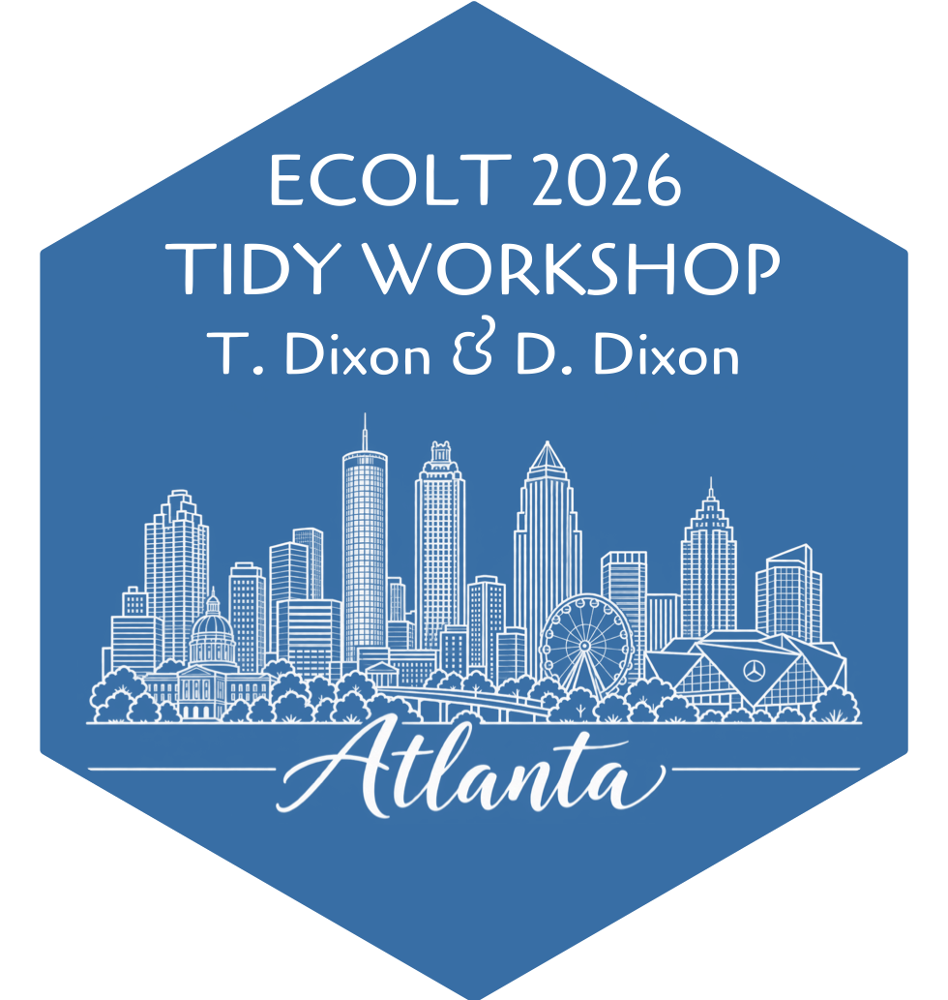
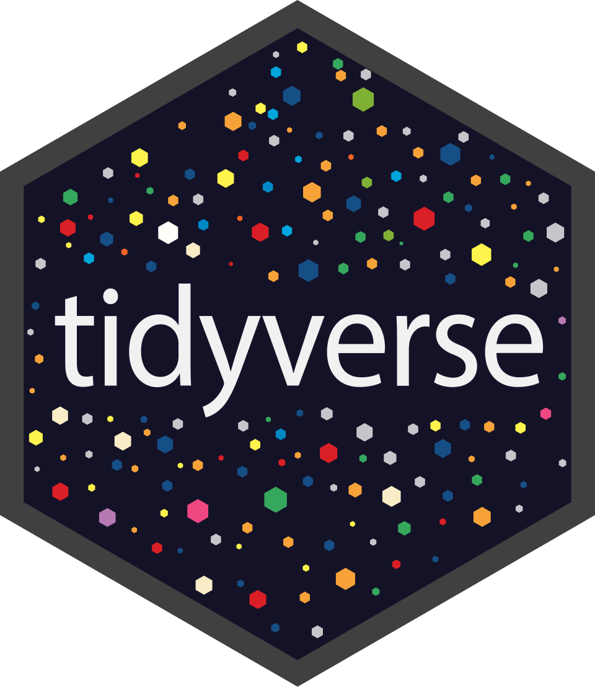



|                                  |                                   |
|---------------------------------:|:----------------------------------|
| {width="294"} | {width="274"} |

These are the stickers you will receive at the end of the workshop! 🙂

### **Logistics**

- Today's activities are web-based; that is, you do not need to download any software. R will magically run in your browser! When you use R on your own, you will need the following software: R and RStudio. At the end of the workshop, you will be given resources to help you (a) install these software and (b) become familiar with their interface.

- You can edit the code chunks in any way you want. When you want a code chunk to return to its original state, just click on "Start Over."

- If you refresh the page, you will lose your progress, so at the end of each page, you may want to print your progress as a PDF file.

### Objectives

By the end of the workshop, you will be able to

- identify some key functions of R

- define foundational R terminology such as *object*, *function*, *package*, *library*, and *argument*

- summarize numerical variables using descriptive statistics such as mean, standard deviation, min, max, and median (resources for categorical variables will be provided but not covered in the workshop)

- visualize data in scatter plots and box plots (resources for bar plots and histograms will be provided but not covered in the workshop)

- "wrangle" data by dropping NA observations, creating new variables based on existing variables, and filtering data based on desired parameters

### Rough Schedule

- **1 PM - 2:45 PM:** Introductions and the tabs *The Foundation* and *Descriptives & Data Wrangling*

- **2:45 PM - 3:00 PM:** 15-min break

- **3:00 PM - 5:00 PM:** The last three tabs *Visualizations Part I*, *Visualizations Part II*, *Moving Forward*
